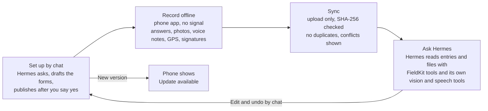
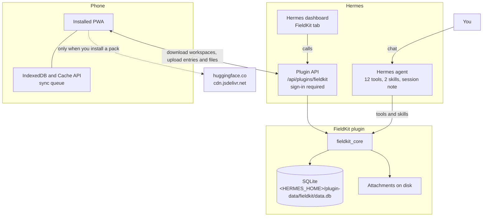

# FieldKit for Hermes Agent

**Record offline. Sync when back online. Ask your Hermes agent about what you recorded.**

FieldKit is an offline observation collection and synchronisation plugin for Hermes. You describe your work to Hermes in a
chat, and Hermes builds the forms. On your phone you fill them in with no signal. When you are back online, the entries
and their files upload to Hermes, and you ask Hermes about them.

FieldKit is not an assistant, a research tool or a decision system. It never calls a model. Hermes does any analysis,
with its own tools, when you ask.

## Demo video

<a href="https://youtube.com/shorts/yFwQ6QpygDU?feature=share"></a>

The demo shows FieldKit being used to document a village water pump identified as WP-007. An observation is recorded
offline, including the pump's condition, a photograph and a voice note. Once connectivity returns, the observation
synchronizes to Hermes, where the original field data and attachments can be retrieved.

## How it works



## Quick start
```bash
hermes plugins install Snehal707/fieldkit && hermes plugins enable fieldkit
```
No restart is needed. Then, in a new Hermes session (Mobile, chat or dashboard):

> "Set up FieldKit for my work."

Hermes asks what you record, shows you the forms, and publishes the workspace after you say yes. It returns a link. Open
the link on your phone, sign in once, tap **Download everything for offline**, and add the app to your home screen.
Details: [docs/INSTALL.md](docs/INSTALL.md).

## Example conversation

An example of the setup chat:

```text
You:    Set up FieldKit for my work. I check vaccine fridges at health centres.

Hermes: What do you record for each check?

You:    The centre name, the date, the fridge temperature in °C (normal 2 to 8),
        a photo of the log, and notes.

Hermes: Here is the draft, one form: Vaccine fridge check
        - Centre name (text, required)
        - Date (date, required)
        - Fridge temperature in °C (number, required). Help text: Normal: 2-8 °C
        - Photo of the log (photo)
        - Notes (multiline)
        Publish this?

You:    Yes

Hermes: Published.
        https://<your-hermes>/dashboard-plugins/fieldkit/app_dist/index.html#/workspace/vaccine-fridge-checks
```

## How it works in detail

### 1. Set up by chat
Hermes asks what the workspace is for, which languages you use (English or Hindi), and what each entry records. A
workspace has one or more **forms**. Each form has questions of these types: text, multiline text, number, date, time,
checkbox, single choice, multiple choice, photo, audio (voice note), GPS, signature and instruction. A signature field is
added only when you ask for one (for example consent or sign-off).

- Questions can be required, or shown only when a condition holds. They can have validation rules and units.
- A normal or safe range is shown as help text, so any reading can still be saved.
- A form can name the field that identifies what an entry is about (a site, a person, an asset). Earlier entries of the
  same subject can then be found.
- Notes and issues are ordinary fields.
- FieldKit checks every form Hermes writes. It repairs common shape mistakes (for example "select" becomes a single
  choice) and reports precise errors for conditions.
- Hermes publishes only after you say yes to the drafted forms. It then returns a link, which opens the workspace on
  your phone.

### 2. Record offline (phone)
- Forms with conditions, validation, units, photos (compressed), voice notes, GPS and signatures. A draft is saved as soon as you start answering.
- Each entry keeps the form version it was made with.
- Optional tools, installed from **Offline Packs**: **Scan text** (OCR in English or Hindi; also **Extract text** on a
  photo inside a form) and **Translate** (English ↔ Hindi).
- **Backup & recovery** (Settings): **Export data** saves everything on the device (records, media, reports, drafts)
  to a file. **Import backup** checks the whole file first (structure and every file's SHA-256), then writes
  all-or-nothing. It remembers the Hermes account and asks before importing another account's backup.

### 3. Sync (upload only)
Entries and files upload when the app is open and the phone is online. Each file is checked by SHA-256, and a resend
never creates a duplicate.

If an entry was changed on two devices, a conflict is shown for you to resolve. The conflict shows which entry and which
answers differ. You resolve conflicts one at a time, after you choose, on the dashboard or by asking Hermes. An expired
sign-in pauses the queue without losing anything.

**Syncing only uploads. Nothing is processed.**

### 4. Ask your Hermes agent
Hermes reads what you synced through FieldKit's tools: entries (filtered by workspace, form, subject or date), one entry
with its answers and the earlier entries of the same subject, and its photos, voice notes and signatures as local files.
Hermes looks at photos and listens to voice notes with its own tools, when you ask. For example:
- "What do the photos from the kitchen visit show?"
- "Summarise my surveys from last month."
- "Is this inspection worse than the last one for this pump?"

### 5. Edit and undo by chat
Ask for a change: "Add a question about the door seal", "remove the GPS field", "change the purpose". Hermes changes only
what you asked, shows the changes, and asks "Publish these changes?". Each change is a new version, and Hermes publishes
only after you approve. The phone then shows **Update available** with the changes.

Entries keep the questions and answers they were recorded with, including questions that were later removed.
**"Undo my last workspace update"** republishes the previous version as a new version.

## Architecture



The phone app is served by the dashboard. For the components, the sync flow and the workspace lifecycle, see
[ARCHITECTURE.md](ARCHITECTURE.md).

## What's in the plugin

| Part | What it is |
|---|---|
| **Hermes tools** | 12 tools (see [docs/API.md](docs/API.md)): set up, change, publish and undo workspaces; read entries, attachments, sync status and conflicts; the phone link. |
| **Skills** | `fieldkit` (find and read entries; Hermes analyses them with its own tools) and `fieldkit-workspace-builder` (set up, change and undo workspaces). |
| **Session note** | One short note in each new Hermes session that lists your workspaces. |
| **Phone app (PWA)** | Installable, works offline, with a Back button on nested screens. Bottom bar: Home, Workspace, Records, Sync, Settings. Served at `/dashboard-plugins/fieldkit/app_dist/index.html`. |
| **Dashboard tab** | Overview, Records (answers and attachments), Synchronization (devices and conflicts), Mobile Access (link and QR code). |
| **Setting** | `public_url` only (optional). |

The plugin registers no hooks, runs no background worker and never calls a model.

## Docs
[ARCHITECTURE.md](ARCHITECTURE.md) · [docs/INSTALL.md](docs/INSTALL.md) · [docs/API.md](docs/API.md) ·
[docs/TESTING.md](docs/TESTING.md) · [THIRD_PARTY.md](THIRD_PARTY.md)

MIT licensed.
